# CITCI GradeTrack — Entity Relationship Diagram

Generated from the Django models (`tools/generate_erd.py`) — never hand-edited, so it can never drift from the actual migrations. Regenerate with `python tools/generate_erd.py` after any model change.

```mermaid
erDiagram
    User ||--o{ AuditLog : "actor"
    User ||--o{ AuditLog : "target_user"
    AcademicYear ||--o{ Semester : "academic_year"
    User ||--o{ Program : "program_head"
    Program ||--o{ Major : "program"
    Program ||--o{ Section : "program"
    Major ||--o{ Section : "major"
    AcademicYear ||--o{ Section : "academic_year"
    Program ||--o{ Subject : "program"
    Major ||--o{ Subject : "major"
    User ||--o{ StudentProfile : "user"
    Program ||--o{ StudentProfile : "program"
    Major ||--o{ StudentProfile : "major"
    Section ||--o{ StudentProfile : "section"
    Subject ||--o{ ClassOffering : "subject"
    Semester ||--o{ ClassOffering : "semester"
    User ||--o{ ClassOffering : "instructor"
    ClassOffering }o--o{ Section : "sections"
    User ||--o{ ClassRosterEntry : "student"
    ClassOffering ||--o{ ClassRosterEntry : "class_offering"
    ClassOffering ||--o{ TeachingAssignmentLog : "class_offering"
    User ||--o{ TeachingAssignmentLog : "old_instructor"
    User ||--o{ TeachingAssignmentLog : "new_instructor"
    User ||--o{ TeachingAssignmentLog : "changed_by"
    GradingTemplate ||--o{ GradingComponent : "template"
    ClassOffering ||--o{ ClassGradingScheme : "class_offering"
    GradingTemplate ||--o{ ClassGradingScheme : "source_template"
    ClassGradingScheme ||--o{ SchemeComponent : "scheme"
    ClassOffering ||--o{ AssessmentItem : "class_offering"
    SchemeComponent ||--o{ AssessmentItem : "component"
    ClassRosterEntry ||--o{ Score : "roster_entry"
    AssessmentItem ||--o{ Score : "item"
    User ||--o{ Score : "updated_by"
    ClassGradingScheme ||--o{ SchemeComponentChangeLog : "scheme"
    User ||--o{ SchemeComponentChangeLog : "changed_by"
    Score ||--o{ ScoreChangeLog : "score"
    User ||--o{ ScoreChangeLog : "changed_by"
    ClassOffering ||--o{ GradeSheet : "class_offering"
    User ||--o{ GradeSheet : "submitted_by"
    User ||--o{ GradeSheet : "approved_by"
    User ||--o{ GradeSheet : "released_by"
    User ||--o{ GradeSheet : "locked_by"
    GradeSheet ||--o{ GradeSheetEntry : "sheet"
    ClassRosterEntry ||--o{ GradeSheetEntry : "roster_entry"
    GradeSheet ||--o{ GradeSheetTransition : "sheet"
    User ||--o{ GradeSheetTransition : "actor"
    GradeSheetEntry ||--o{ GradeCorrection : "entry"
    User ||--o{ GradeCorrection : "corrected_by"
    ClassRosterEntry ||--o{ Prediction : "roster_entry"
    MlModelVersion ||--o{ Prediction : "model_version"
    User ||--o{ HistoricalImportBatch : "uploaded_by"
    HistoricalImportBatch ||--o{ HistoricalRecord : "batch"
    ClassRosterEntry ||--o{ Intervention : "roster_entry"
    User ||--o{ Intervention : "created_by"
    User ||--o{ Notification : "recipient"
    User {
        bigint id PK
        varchar password
        timestamptz last_login
        boolean is_superuser
        varchar username
        varchar first_name
        varchar last_name
        varchar email
        boolean is_staff
        boolean is_active
        timestamptz date_joined
        varchar role
        varchar middle_name
        varchar id_number
        boolean must_change_password
        timestamptz privacy_consent_at
        bigint groups
        bigint user_permissions
    }
    AuditLog {
        bigint id PK
        timestamptz created_at
        timestamptz updated_at
        bigint actor_id FK
        varchar action
        bigint target_user_id FK
        jsonb details
    }
    AcademicYear {
        bigint id PK
        timestamptz created_at
        timestamptz updated_at
        int_unsigned start_year
        int_unsigned end_year
    }
    Semester {
        bigint id PK
        timestamptz created_at
        timestamptz updated_at
        bigint academic_year_id FK
        varchar term
        date start_date
        date end_date
        boolean is_active
    }
    Program {
        bigint id PK
        timestamptz created_at
        timestamptz updated_at
        varchar code
        varchar name
        bigint program_head_id FK
        boolean is_active
    }
    Major {
        bigint id PK
        timestamptz created_at
        timestamptz updated_at
        bigint program_id FK
        varchar code
        varchar name
        boolean is_active
    }
    Section {
        bigint id PK
        timestamptz created_at
        timestamptz updated_at
        bigint program_id FK
        bigint major_id FK
        bigint academic_year_id FK
        smallint_unsigned year_level
        varchar name
    }
    Subject {
        bigint id PK
        timestamptz created_at
        timestamptz updated_at
        varchar code
        varchar title
        decimal units
        bigint program_id FK
        bigint major_id FK
        smallint_unsigned year_level
        varchar term
        boolean is_active
    }
    StudentProfile {
        bigint id PK
        timestamptz created_at
        timestamptz updated_at
        bigint user_id FK
        bigint program_id FK
        bigint major_id FK
        smallint_unsigned year_level
        bigint section_id FK
    }
    ClassOffering {
        bigint id PK
        timestamptz created_at
        timestamptz updated_at
        bigint subject_id FK
        bigint semester_id FK
        bigint instructor_id FK
        varchar schedule
        varchar room
        boolean is_active
        bigint sections
    }
    ClassRosterEntry {
        bigint id PK
        timestamptz created_at
        timestamptz updated_at
        bigint student_id FK
        bigint class_offering_id FK
        varchar status
        date date_added
        date date_dropped
        boolean is_incomplete
        varchar incomplete_reason
    }
    TeachingAssignmentLog {
        bigint id PK
        timestamptz created_at
        timestamptz updated_at
        bigint class_offering_id FK
        bigint old_instructor_id FK
        bigint new_instructor_id FK
        bigint changed_by_id FK
        boolean is_admin_override
        varchar reason
    }
    GradingTemplate {
        bigint id PK
        timestamptz created_at
        timestamptz updated_at
        varchar name
        varchar description
        boolean is_default
        boolean is_active
    }
    GradingComponent {
        bigint id PK
        timestamptz created_at
        timestamptz updated_at
        bigint template_id FK
        varchar name
        varchar category
        int_unsigned weight
        boolean is_locked
        smallint_unsigned order
    }
    ClassGradingScheme {
        bigint id PK
        timestamptz created_at
        timestamptz updated_at
        bigint class_offering_id FK
        bigint source_template_id FK
    }
    SchemeComponent {
        bigint id PK
        timestamptz created_at
        timestamptz updated_at
        bigint scheme_id FK
        varchar name
        varchar category
        int_unsigned weight
        boolean is_locked
        smallint_unsigned order
    }
    AssessmentItem {
        bigint id PK
        timestamptz created_at
        timestamptz updated_at
        bigint class_offering_id FK
        bigint component_id FK
        varchar title
        int_unsigned max_score
        varchar term
        date date
        smallint_unsigned order
    }
    Score {
        bigint id PK
        timestamptz created_at
        timestamptz updated_at
        bigint roster_entry_id FK
        bigint item_id FK
        int_unsigned score
        bigint updated_by_id FK
    }
    SchemeComponentChangeLog {
        bigint id PK
        bigint scheme_id FK
        varchar action
        varchar component_name
        jsonb before
        jsonb after
        bigint changed_by_id FK
        timestamptz changed_at
    }
    ScoreChangeLog {
        bigint id PK
        bigint score_id FK
        int_unsigned old_value
        int_unsigned new_value
        bigint changed_by_id FK
        timestamptz changed_at
    }
    GradeSheet {
        bigint id PK
        timestamptz created_at
        timestamptz updated_at
        bigint class_offering_id FK
        varchar period
        varchar status
        timestamptz submitted_at
        bigint submitted_by_id FK
        timestamptz approved_at
        bigint approved_by_id FK
        timestamptz released_at
        bigint released_by_id FK
        timestamptz locked_at
        bigint locked_by_id FK
        text return_remarks
    }
    GradeSheetEntry {
        bigint id PK
        timestamptz created_at
        timestamptz updated_at
        bigint sheet_id FK
        bigint roster_entry_id FK
        decimal final_grade
        varchar remarks
        varchar inc_reason
        jsonb components_json
    }
    GradeSheetTransition {
        bigint id PK
        timestamptz created_at
        timestamptz updated_at
        bigint sheet_id FK
        varchar from_status
        varchar to_status
        bigint actor_id FK
        text remarks
    }
    GradeCorrection {
        bigint id PK
        timestamptz created_at
        timestamptz updated_at
        bigint entry_id FK
        decimal old_grade
        decimal new_grade
        varchar old_remarks
        varchar new_remarks
        text reason
        bigint corrected_by_id FK
    }
    MlModelVersion {
        bigint id PK
        timestamptz created_at
        timestamptz updated_at
        varchar checkpoint
        timestamptz trained_at
        varchar training_source
        int_unsigned n_samples
        decimal positive_rate
        decimal threshold
        jsonb metrics_json
        jsonb cv_json
        jsonb confusion_matrix_json
        jsonb coefficients_json
        jsonb feature_list
        boolean is_active
        varchar model_file
    }
    Prediction {
        bigint id PK
        timestamptz created_at
        timestamptz updated_at
        bigint roster_entry_id FK
        varchar checkpoint
        bigint model_version_id FK
        decimal probability
        varchar label
        jsonb contributions_json
        timestamptz computed_at
        timestamptz instructor_notified_at
        timestamptz student_notified_at
    }
    HistoricalImportBatch {
        bigint id PK
        timestamptz created_at
        timestamptz updated_at
        bigint uploaded_by_id FK
        int_unsigned file_count
        int_unsigned row_count
        int_unsigned positive_count
        text term_assignment_note
        jsonb skipped_rows_json
    }
    HistoricalRecord {
        bigint id PK
        varchar masked_id
        varchar semester_label
        varchar subject_code
        varchar checkpoint
        jsonb features_json
        smallint_unsigned label
        bigint batch_id FK
    }
    Intervention {
        bigint id PK
        timestamptz created_at
        timestamptz updated_at
        bigint roster_entry_id FK
        bigint created_by_id FK
        date date
        varchar type
        text notes
        date follow_up_date
        varchar outcome
    }
    InstitutionSettings {
        bigint id PK
        timestamptz created_at
        timestamptz updated_at
        varchar school_name
        varchar sub_line
        varchar address
        varchar department
        filefield logo
        varchar dean_name
        varchar dean_title
        varchar academic_head_name
        varchar academic_head_title
        varchar registrar_name
        varchar registrar_title
        boolean show_unofficial_scores_to_students
        boolean show_forecasts_to_students
        text privacy_notice_text
        varchar data_privacy_officer_contact
    }
    Notification {
        bigint id PK
        bigint recipient_id FK
        varchar title
        text message
        varchar link
        boolean is_read
        timestamptz created_at
    }
```

