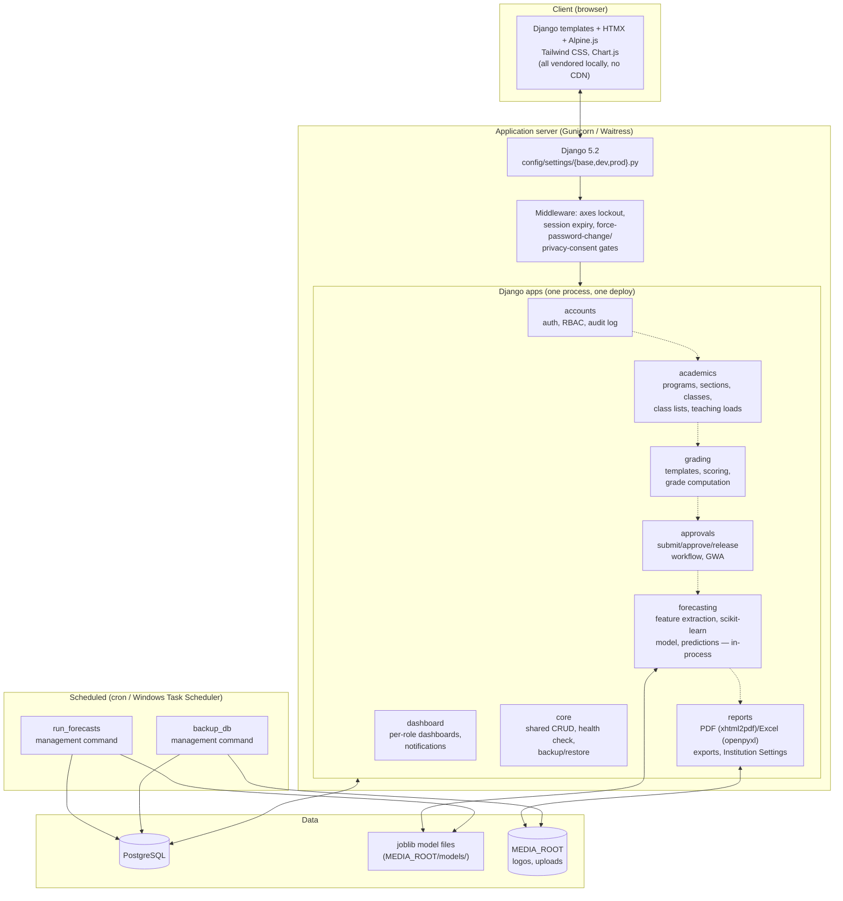

# System Architecture

The current design (CLAUDE.md Tech Stack) — Django monolith, PostgreSQL, forecasting running
**in-process** (no separate FastAPI "ml-service", superseded before anything was built; see
`docs/CHANGES_FROM_PROPOSAL.md`). No task queue — predictions are cheap enough to run
synchronously after a score save, plus a schedulable `run_forecasts` management command.

**Why no separate ML service:** at CITCI's data scale, a same-process `forecasting/ml/` package
does the same job as the originally-proposed FastAPI service with no deployment/availability story
to build — Django can't "lose connectivity" to code running in its own process. See
`docs/CHANGES_FROM_PROPOSAL.md` for the full list of deviations from the approved proposal.
