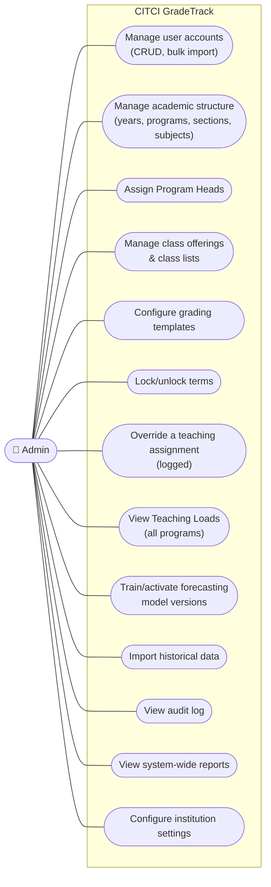
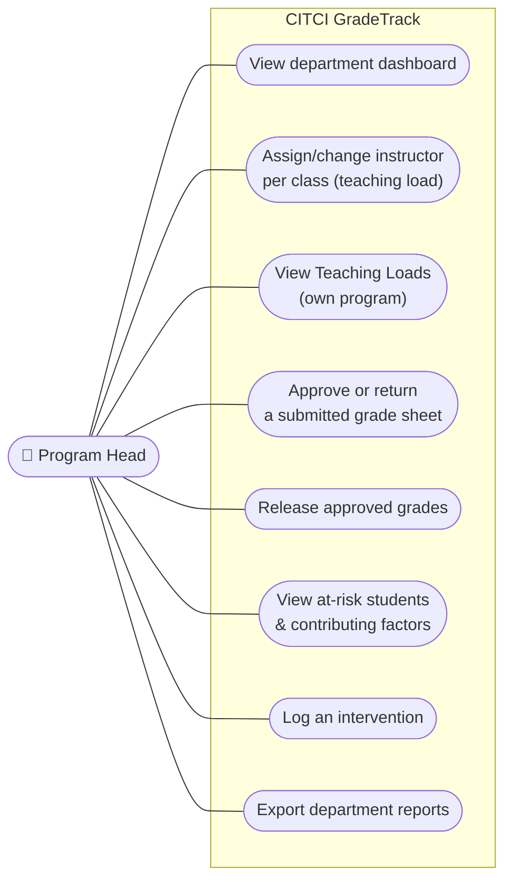
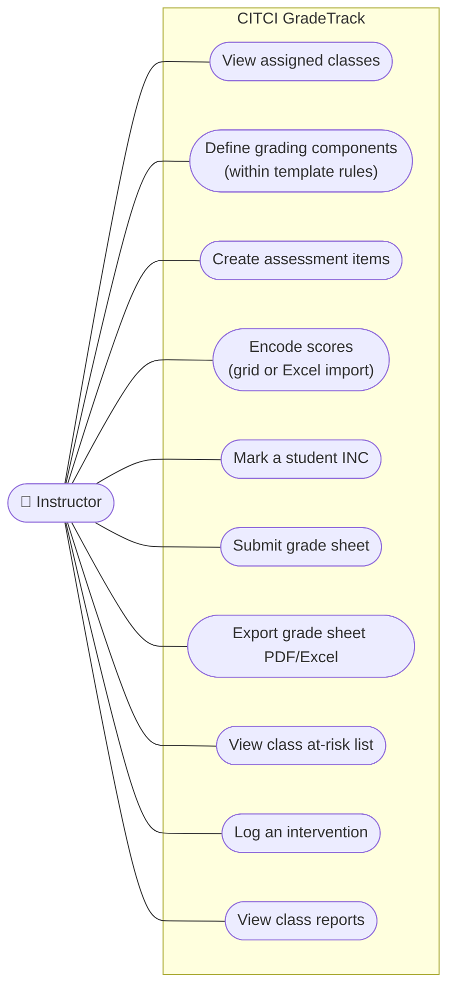
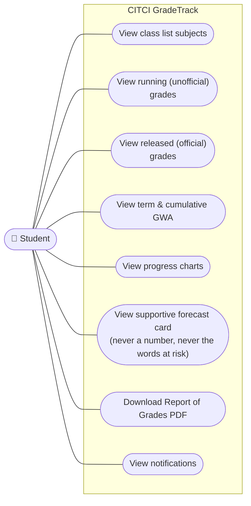

# Use Case Diagrams (per role)

Mermaid has no dedicated UML use-case shape, so each diagram below approximates one: the actor is
a node outside the system boundary, each use case is a stadium/pill shape (`([Use case])`) inside
a `subgraph` standing in for the system boundary.

## Admin

## Program Head

## Instructor

## Student

